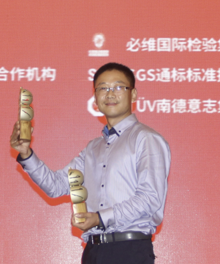

吴树升，男，汉族，出生于内蒙古赤峰市，毕业于东南大学机械设计与自动化专业。毕业后从事产品开发设计工作16年。

苏州澎逸运动用品有限公司创始人。澎逸折叠皮划艇发明人。中国发明家协会会员。中国皮划艇公开水域教练。专注大众皮划艇运动的普及和推广。

凭借本身的技术优势以及对于水上运动的爱好。自2003年开始设计开发制作了折叠钓鱼船、折叠独木舟、海洋舟、木工冲锋艇、木工帆船等不同类型的多种水上娱乐产品。同时也累计了大量的户外旅行探险经验。

2012年苏州澎逸运动用品有限公司成立后，专注于水上娱乐船舶开发加工制作。拥有28项国家专利，其中发明专利四项。2018年翻译整理了《静水皮划艇入门与提高》一书。在澎逸运作的8年历程中，累计了大量的产品制作、完善、加工经验。

本书为吴树升先生艺术级皮划艇制作实践经验的总结和分享。由衷地希望本书可以为国内皮划艇爱好者打开一个DIY之门。让皮划艇装备色彩纷呈，让每个爱好者享受水上运动的乐趣的同时也可以享受自由制作之美。让艺术级的作品在自己手中诞生。

